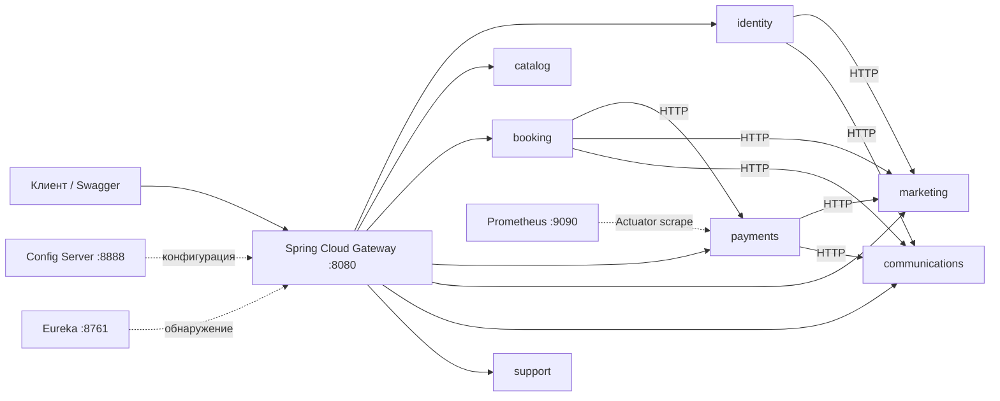

# Native Travel: семь сервисов и Spring Cloud

В стандартном Docker Compose запускаются **семь отдельных бизнес-приложений**.
Каждое содержит только свои реализации и REST-контроллеры, собирается в собственный
исполняемый JAR и регистрируется в Eureka. Config Server, Eureka Server и Gateway —
три дополнительных инфраструктурных приложения.

| Сервис | Домен | Порт на хосте | Основные API через Gateway |
|---|---|---:|---|
| identity | Пользователи, JWT, профиль | 8081 | `/api/v1/auth/**`, `/api/v1/profile/**` |
| catalog | Туры, отели, рейсы, сравнение, отзывы | 8082 | `/api/v1/tours/**`, `/api/v1/flights/**`, `/api/v1/reviews/**` |
| booking | Корзина, бронирования, отмена | 8083 | `/api/v1/cart/**`, `/api/v1/bookings/**` |
| payments | Существующая имитация оплаты и подтверждение брони | 8084 | `/api/v1/payments` |
| marketing | Промокоды, рефералы, опросы, избранное | 8085 | `/api/v1/promocodes/**`, `/api/v1/surveys/**`, `/api/v1/favorites/**` |
| communications | Email, подписки, QR, PDF | 8086 | `/api/v1/subscriptions/**`, `/api/v1/documents/**` |
| support | Поддержка, STOMP/SockJS | 8087 | `/api/v1/support/**`, `/ws/**` |



## Сборка и запуск

Нужны JDK 21, Maven Wrapper и Docker Compose. Порты старого приложения должны быть
свободны перед запуском нового Compose; существующий том `postgres_data` сохраняется.
Используются Spring Boot 3.3.13 и Spring Cloud 2023.0.6: патч Boot согласован с
требованиями Gateway к Spring Framework.

```powershell
Copy-Item .env.example .env # только если своего .env ещё нет
.\mvnw.cmd clean verify
docker compose down --remove-orphans # при переходе с прежнего Compose; том БД сохраняется
docker compose up -d --build
docker compose ps
```

Linux/macOS: `./mvnw clean verify`. В `.env` задаются параметры БД, `JWT_SECRET`
и `INTERNAL_SERVICE_TOKEN`. Имена бизнес-сервисов совпадают с именами Config/Eureka.
Переменные `CONFIG_SERVER_URL`, `EUREKA_URL` и `PORT` внутри Compose уже настроены.

| Интерфейс | Адрес |
|---|---|
| Gateway и выбор Swagger семи сервисов | http://localhost:8080/swagger-ui.html |
| Eureka: ожидаются семь бизнес-сервисов и Gateway | http://localhost:8761 |
| Конфигурация catalog для distributed | http://localhost:8888/catalog/distributed |
| Prometheus, Targets | http://localhost:9090/targets |
| MailHog | http://localhost:8025 |

Индивидуальные Swagger UI: `http://localhost:8081/swagger-ui.html` …
`http://localhost:8087/swagger-ui.html`; спецификация каждого — `/v3/api-docs`.
Через Gateway спецификации доступны как `/openapi/identity`, `/openapi/catalog`
и аналогично для остальных сервисов. JWT вводится кнопкой Authorize; Gateway
передаёт Authorization и cookies, а каждый бизнес-сервис проверяет JWT.

При локальном запуске сначала стартуют Config Server и Eureka, затем сервисы:

```powershell
java -jar modules/config-server/target/config-server-0.0.1-SNAPSHOT-exec.jar
java -jar modules/discovery-server/target/discovery-server-0.0.1-SNAPSHOT-exec.jar
java -jar modules/catalog/target/catalog-0.0.1-SNAPSHOT-exec.jar
```

Команды выполняются из корня репозитория в отдельных терминалах. По умолчанию
Config Server читает `./config-repo`, бизнес-сервисы используют локальную PostgreSQL.

## Централизованная конфигурация

`config-repo/application.yml` содержит общие настройки Eureka, логов, Actuator и
Resilience4j; `application-distributed.yml` — БД и SMTP. Файлы `identity.yml` …
`support.yml` задают настройки доменов. `gateway.yml` содержит маршруты `lb://...`.
Config Server использует native backend с read-only mount каталога `config-repo`.
Клиенты импортируют конфигурацию обязательным `configserver:`: при недоступном
Config Server запуск завершается ошибкой. Изменения конфигурации применяются
после перезапуска соответствующего сервиса; автоматический refresh не настроен.

## Circuit Breaker

В Gateway каждая бизнес-маршрутизация использует Spring Cloud CircuitBreaker с
Resilience4j. Сетевые ошибки и HTTP 500/502/503/504 приводят к JSON ProblemDetail
с HTTP **503**, именем сервиса и указанием проверить результат перед повтором
изменяющего запроса. Автоматических повторов платежей нет.

HTTP-клиенты внутри сервисов используют Eureka + Spring Cloud LoadBalancer и
CircuitBreakerFactory. Окно — 10 вызовов, минимум — 5, порог ошибок — 50%, открытое
состояние — 15 секунд, два пробных вызова в half-open. Ошибки HTTP 4xx не считаются
сбоем доступности. Connect timeout — 2 секунды, read timeout — 8 секунд,
TimeLimiter — 10 секунд. Gateway response timeout — 12 секунд.

Проверка отказа на тестовом стенде:

```powershell
docker compose stop support
# Несколько POST /api/v1/support/messages вернут 503, а catalog продолжит отвечать.
node scripts/verify-circuit.cjs down
docker compose start support
# После обновления реестра, кешей и half-open запросы снова проходят.
node scripts/verify-circuit.cjs up
```

Внутренние `/internal/**` требуют `X-Service-Token`, не маршрутизируются через
Gateway и исключены из публичного Swagger. Gateway удаляет входящий служебный
заголовок, поэтому клиент не может передать его соседним сервисам через Gateway.

## Мониторинг и логи

Каждое приложение публикует `/actuator/health`, `/actuator/info`,
`/actuator/metrics`, `/actuator/prometheus`; бизнес-сервисы и Gateway также имеют
`/actuator/health/readiness` и `/actuator/health/liveness`.
Compose ожидает готовности Config Server и Eureka перед запуском клиентов.
Prometheus опрашивает все десять Java-приложений раз в 15 секунд.

Примеры PromQL: `up{job="native-travel"}`,
`rate(http_server_requests_seconds_count[1m])`, `jvm_memory_used_bytes`.
Метрики Resilience4j появляются после первых вызовов защищённых маршрутов.

```powershell
docker compose logs -f gateway booking payments communications
```

Логи содержат имя сервиса, request ID, HTTP-метод, путь, статус и длительность.
`X-Request-Id` проходит через Gateway и внутренние HTTP-вызовы. Тела запросов,
JWT, сервисные токены и реквизиты карты не выводятся HTTP-фильтрами. Docker
ограничивает каждый файл логов 10 МБ и сохраняет три файла на контейнер.

## Проверки

`./mvnw verify` запускает прежние регрессионные тесты и проверки внутренних
учётных данных и request ID. Для тестов без внешнего Telegram нужно установить
`TELEGRAM_BOT_ENABLED=false`.

На **тестовой БД** можно выполнить `node scripts/verify-cloud.cjs` (Node.js 18+).
Сценарий создаёт пользователя, бронь и имитированный платёж; проверяет Config,
регистрацию семи сервисов, раздельные OpenAPI, маршрутизацию, маркетинговые
HTTP-вызовы, QR/PDF, поддержку, SockJS и сбор метрик Prometheus.
Адреса стенда переопределяются переменными `GATEWAY_URL`, `EUREKA_URL`,
`CONFIG_SERVER_URL`, `PROMETHEUS_URL`.

## Границы текущей реализации

Сервисы запускаются независимо и общаются по HTTP, но **пока используют общую
схему PostgreSQL и общую библиотеку JPA-моделей/репозиториев**. Flyway использует
общую таблицу истории и блокировки миграций. Это переходная архитектура: данные
сохранены, но независимость хранения ещё не достигнута. Сетевые вызовы не образуют
общую ACID-транзакцию; для промышленной обработки платежей нужны outbox и
идемпотентные обработчики побочных действий. Оплата остаётся имитацией.

Прежний Thymeleaf-интерфейс, административные экраны и Telegram сохранены в
`modules/application` как необязательное приложение совместимости. Они не
являются отдельным восьмым бизнес-сервисом и не запускаются в стандартном стеке.
Для просмотра старого интерфейса: `docker compose --profile legacy up -d --build
legacy-web`, адрес http://localhost:8090. На порту 8080 новый Gateway открывает
Swagger; перенос Thymeleaf на полноценный BFF ещё не выполнен.

## PostgreSQL host port

Docker Compose publishes PostgreSQL at localhost:15432 (container services use postgres:5432). Override the host port with POSTGRES_HOST_PORT in .env if needed. For Java applications running on the host, set SPRING_DATASOURCE_URL=jdbc:postgresql://localhost:15432/nativetravel_db.

If Windows rejects a port binding, check Get-NetTCPConnection -LocalPort 5432 and netsh interface ipv4 show excludedportrange protocol=tcp. After changing the mapping, run docker compose up -d postgres, then docker compose up -d.
