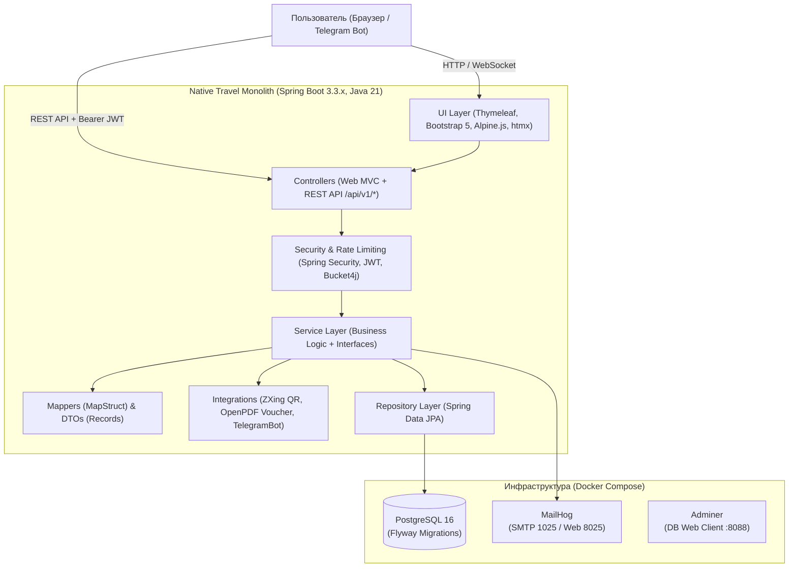

# Native Travel — Туристическое агентство

Монолитное веб-приложение для туристического агентства: поиск и бронирование туров и авиабилетов, оформление заказов с промокодами, имитация оплаты (СБП, карта, крипта, наличные), генерация PDF-ваучеров и QR-кодов, личный кабинет путешественника, панель администратора, многоязычность (i18n), чат поддержки с эскалацией и Telegram-бот.

---

## Архитектура системы



---

## Стек технологий

- **Backend:** Java 21, Spring Boot 3.3.5 (Web, Data JPA, Security, Validation, Mail, WebSocket, Actuator)
- **База данных:** PostgreSQL 16, Flyway (версионированные миграции)
- **Frontend:** Thymeleaf, Bootstrap 5.3, Alpine.js, htmx, Bootstrap Icons
- **Документация API:** springdoc-openapi 2.6.0 (Swagger UI на `/swagger-ui.html`)
- **Безопасность:** Spring Security, JWT (jjwt 0.12.6) + HttpOnly Refresh Cookie, Bucket4j
- **Генерация документов:** ZXing (QR-коды), OpenPDF (PDF-ваучеры)
- **Тестирование:** JUnit 5, Mockito, Testcontainers (PostgreSQL)
- **Инфраструктура:** Docker Compose, GitHub Actions, GHCR, Render

---

## Быстрый старт

### 1. Клонирование и настройка переменных окружения
```bash
cp .env.example .env
```

### 2. Запуск инфраструктуры в Docker Compose
```bash
docker compose up -d postgres mailhog adminer
```

### 3. Сборка и запуск приложения
```bash
./mvnw clean spring-boot:run
```

После старта приложение доступно по адресам:
- **Главная страница:** [http://localhost:8080](http://localhost:8080)
- **Swagger UI:** [http://localhost:8080/swagger-ui.html](http://localhost:8080/swagger-ui.html)
- **OpenAPI v3 Docs:** [http://localhost:8080/v3/api-docs](http://localhost:8080/v3/api-docs)
- **Health Check:** [http://localhost:8080/actuator/health](http://localhost:8080/actuator/health)
- **MailHog Web UI:** [http://localhost:8025](http://localhost:8025)
- **Adminer (DB Web):** [http://localhost:8088](http://localhost:8088)

---

## Структура пакетов

```
com.nativetravel
├── config       # Конфигурации: Security, OpenAPI, WebMvc, WebSocket
├── controller   # Контроллеры: web (Thymeleaf) и rest (/api/v1/*)
├── dto          # DTO структуры (Java records)
├── entity       # JPA сущности
├── repository   # Spring Data JPA интерфейсы
├── service      # Сервисный слой (интерфейсы и реализации)
├── exception    # Кастомные исключения и GlobalExceptionHandler (ProblemDetail)
├── security     # JWT провайдер, токены, фильтры безопасности
├── mapper       # MapStruct мапперы
├── i18n         # Интернационализация (ru, en, kk, be)
├── bot          # Telegram-бот и обработчики команд
└── util         # Утилиты (QR, PDF, Rate Limiting)
```
