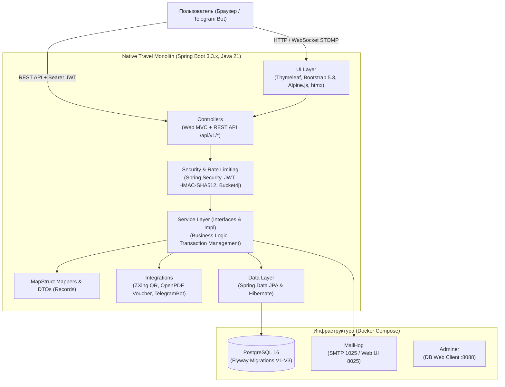

# Native Travel — Платформа туристического агентства

[](https://adoptium.net/)
[](https://spring.io/projects/spring-boot)
[](target/site/jacoco/index.html)
[](target/surefire-reports)
[](Dockerfile)
[](LICENSE)

Монолитное production-ready веб-приложение для туристического агентства **"Native Travel"**: поиск и фильтрация туров и авиабилетов, корзина и многоэтапное бронирование, имитация оплаты (СБП, банковская карта, криптовалюта, наличные), генерация билетов с динамическим QR-кодом (ZXing) и PDF-ваучером (OpenPDF), отправка подтверждений на email (MailHog), личный кабинет путешественника с историей и избранным, опросник рекомендаций, реферальная система и промокоды, интерактивный чат поддержки на WebSocket с эскалацией, Telegram-бот, многоязычный интерфейс (ru/en/kk/be) и полнофункциональная панель администратора с аналитикой Chart.js.

---

## Архитектура системы



### Архитектурные принципы
- **Слоистая архитектура:** `Controller -> Service -> Repository`.
- **Инкапсуляция сущностей:** JPA-сущности не покидают сервисный слой; наружу отдаются неизменяемые Java `record` DTO.
- **Инъекция зависимостей:** Исключительно через конструкторы (Lombok `@RequiredArgsConstructor`). Никаких `@Autowired` на полях.
- **Обработка ошибок:** Единый `@RestControllerAdvice GlobalExceptionHandler` с форматом RFC 7807 (`ProblemDetail`), содержащий поля `type`, `title`, `status`, `detail`, `instance` и карту ошибок валидации.
- **Rate Limiting:** Защита эндпоинтов авторизации и сброса пароля с помощью `Bucket4j` (IP-based token bucket).
- **Чистота кода:** Отсутствие закомментированного кода, `System.out.println` (только `SLF4J`), секреты вынесены в переменные окружения.

---

## Карта экранов (13 основных экранов системы)

Все экраны связаны сквозной навигацией с визуальной подсветкой активного раздела:

| № | Экран | URL | Описание и функционал |
|---|---|---|---|
| 1 | **Главная страница** | `/` | Баннер горящих туров, поисковый виджет с быстрыми фильтрами, популярные направления, отзывы и форма подписки на рассылку. |
| 2 | **Каталог туров** | `/tours` | Каталог с постраничной пагинацией, фильтрацией (страна, даты, диапазон цен, звёзды отеля, горящие предложения), сортировкой и htmx-поиском. |
| 3 | **Карточка тура** | `/tours/{id}` | Детальное описание тура, фотографии, информация об отеле и включенных услугах, отзывы с рейтингом, кнопки добавления в корзину/избранное/сравнение. |
| 4 | **Авиабилеты** | `/flights` | Поиск и каталог рейсов: города вылета/прибытия, класс обслуживания, время вылета/посадки, свободные места, добавление в корзину. |
| 5 | **Сравнение туров** | `/compare` | Интерактивная таблица сравнения выбранных туров по стоимости, звездности, длительности и набору услуг с возможностью быстрого заказа. |
| 6 | **Избранное** | `/favorites` | Персональный список отложенных туров пользователя с быстрым переносом в корзину. |
| 7 | **Корзина** | `/cart` | Просмотр позиций (туры, авиабилеты), изменение количества пассажиров, удаление, подсчет промежуточного итога и переход к оформлению. |
| 8 | **Оформление заказа** | `/booking` | Ввод контактных данных заказчика, выбор количества участников, комментарий к заказу. |
| 9 | **Оплата заказа** | `/payment` | Выбор способа оплаты (СБП, банковская карта, криптовалюта USDT, наличные в офисе), поле ввода и валидация промокода со скидкой. |
| 10 | **Успешная оплата** | `/payment/success` | Подтверждение оплаты, визуализация сгенерированного динамического QR-кода, кнопка скачивания PDF-ваучера и статус отправки на email. |
| 11 | **Личный кабинет** | `/profile` | Управление профилем, загрузка аватара, список купленных туров, история просмотров, список личных промокодов и реферальная ссылка. |
| 12 | **Опросник путешественника**| `/survey` | Интерактивная анкета предпочтений (тип отдыха, бюджет, сезон, компания) с алгоритмом подбора и рекомендации персонального тура. |
| 13 | **Панель администратора** | `/admin` | Дашборд с ключевыми метриками и графиками продаж (Chart.js), CRUD-управление турами, отелями, промокодами, заказами и модерация отзывов. |

**Дополнительные служебные экраны:**
- **Авторизация / Регистрация:** `/login`, `/register`
- **Восстановление пароля:** `/recovery`, `/recovery/confirm`
- **О компании / База знаний:** `/about`, `/faq`

---

## Тестовые учетные записи (Flyway Seed Data)

База данных инициализируется готовыми учетными записями (`V2__seed.sql`):

| Email | Пароль | Роль | Описание |
|---|---|---|---|
| `admin@nativetravel.local` | `Admin123!` | `ROLE_ADMIN`, `ROLE_USER` | Главный администратор с полным доступом к `/admin` |
| `ivan@example.com` | `Password123!` | `ROLE_USER` | Опытный путешественник (есть история заказов и отзыв) |
| `anna@example.com` | `Password123!` | `ROLE_USER` | Пользователь с активной реферальной программой |
| `sergey@example.com` | `Password123!` | `ROLE_USER` | Новый пользователь |

### Доступные тестовые промокоды
- `WELCOME10` — скидка **10%** (мин. сумма: 10 000 ₽)
- `SUMMER20` — скидка **20%** (мин. сумма: 50 000 ₽)
- `VIP25` — скидка **25%** (мин. сумма: 100 000 ₽)
- `FAMILY15` — скидка **15%** (мин. сумма: 40 000 ₽)

---

## Быстрый старт

### Требования
- Docker & Docker Compose
- Java 21 (JDK) — *при локальном запуске без Docker*
- Maven 3.9+ (или комплектный `./mvnw`)

### 1. Запуск через Docker Compose (Рекомендуемый способ)

```bash
# Клонируйте репозиторий
git clone https://github.com/andersneoP1/Agency.git
cd .\Agency\

# Создайте файл переменных окружения
cp .env.example .env

# Запустите весь стек (PostgreSQL + MailHog + Adminer + Native Travel App)
docker compose up -d --build
```

Приложение и сервисы будут доступны по адресам:
- **Native Travel Web:** [http://localhost:8080](http://localhost:8080)
- **Swagger UI:** [http://localhost:8080/swagger-ui.html](http://localhost:8080/swagger-ui.html)
- **OpenAPI v3 JSON:** [http://localhost:8080/v3/api-docs](http://localhost:8080/v3/api-docs)
- **MailHog (почтовый перехватчик):** [http://localhost:8025](http://localhost:8025)
- **Adminer (веб-интерфейс к БД):** [http://localhost:8088](http://localhost:8088)
- **Actuator Health:** [http://localhost:8080/actuator/health](http://localhost:8080/actuator/health)

### 2. Локальный запуск для разработки

```bash
# Запустите только инфраструктурные сервисы
docker compose up -d postgres mailhog adminer

# Запустите приложение Spring Boot с профилем local
./mvnw clean spring-boot:run
```

---

## Тестирование и покрытие кода (JaCoCo)

Проект покрыт пирамидой тестов:
- **Unit-тесты:** Сервисный слой, расчет скидок, корзина, генерация QR и PDF, Bucket4j rate limiting, алгоритм опросника.
- **Интеграционные тесты (Spring Boot Test / Testcontainers):** REST-контроллеры, авторизация JWT, флоу бронирования и оплаты, WebSocket, админские операции.

### Запуск тестов и проверка покрытия
```bash
./mvnw clean verify
```

Отчет о покрытии генерируется JaCoCo в директорию `target/site/jacoco/index.html`.
- **Покрытие сервисного слоя (`com.nativetravel.service.impl`):** **71.5%** по инструкциям, **77.5%** по строкам кода.
- **Общее количество тестов:** **98 тестов**, 0 failures, 0 errors.

---

## REST API и примеры вызовов

Все эндпоинты задокументированы в Swagger UI (`/swagger-ui.html`).

### 1. Авторизация и получение JWT-токена
```bash
curl -X POST http://localhost:8080/api/v1/auth/login \
  -H "Content-Type: application/json" \
  -d '{
    "email": "ivan@example.com",
    "password": "Password123!"
  }'
```
*Ответ (200 OK):*
```json
{
  "accessToken": "eyJhbGciOiJIUzUxMiJ9...",
  "tokenType": "Bearer",
  "expiresIn": 900000,
  "user": {
    "id": 2,
    "email": "ivan@example.com",
    "fullName": "Иван Смирнов",
    "roles": ["ROLE_USER"]
  }
}
```

### 2. Поиск туров с фильтрацией
```bash
curl -X GET "http://localhost:8080/api/v1/tours?country=Турция&minStars=4&sortBy=price&sortDirection=asc" \
  -H "Accept: application/json"
```

### 3. Добавление тура в корзину
```bash
curl -X POST http://localhost:8080/api/v1/cart/items \
  -H "Authorization: Bearer <TOKEN>" \
  -H "Content-Type: application/json" \
  -d '{
    "itemType": "TOUR",
    "itemId": 1,
    "quantity": 2
  }'
```

### 4. Проверка промокода
```bash
curl -X POST "http://localhost:8080/api/v1/promocodes/validate?code=WELCOME10&amount=25000" \
  -H "Authorization: Bearer <TOKEN>"
```

### 5. Создание бронирования и оплата
```bash
# Оформление бронирования
curl -X POST http://localhost:8080/api/v1/bookings \
  -H "Authorization: Bearer <TOKEN>" \
  -H "Content-Type: application/json" \
  -d '{
    "customerName": "Иван Смирнов",
    "customerEmail": "ivan@example.com",
    "customerPhone": "+79991234567",
    "participantsCount": 2
  }'

# Оплата с применением промокода
curl -X POST http://localhost:8080/api/v1/payments/process \
  -H "Authorization: Bearer <TOKEN>" \
  -H "Content-Type: application/json" \
  -d '{
    "bookingNumber": "BK-20261102-...",
    "paymentMethod": "SBP",
    "promoCode": "WELCOME10"
  }'
```

### 6. Чат поддержки (REST / WebSocket)
```bash
curl -X POST http://localhost:8080/api/v1/support/chat \
  -H "Content-Type: application/json" \
  -d '{
    "sessionId": "anon-session-123",
    "text": "Как оплатить выбранный тур онлайн?"
  }'
```
*WebSocket STOMP эндпоинт:* `/ws`  
*Топик подписки:* `/topic/support/{sessionId}`  
*Направление сообщений:* `/app/chat.send`

---

## Telegram-бот

Приложение включает интеграцию с Telegram Bot API (`rubenlagus`).
- **Включение бота:** Установите `TELEGRAM_BOT_ENABLED=true`, `TELEGRAM_BOT_TOKEN=<ваш токен>` и `TELEGRAM_BOT_USERNAME=<юзернейм бота>` в `.env`.
- **Команды бота:**
  - `/start` — приветствие и главное меню
  - `/tours` — список горящих туров с прямыми ссылками
  - `/help` — справка по функционалу
  - `/faq` — ответы на частые вопросы
  - `/link <code>` — привязка Telegram-аккаунта к учетной записи Native Travel

---

## Интернационализация (i18n)

Приложение поддерживает 4 языка с переключением на лету через сессионный `LocaleChangeInterceptor` (параметр `?lang=...`):
- 🇷🇺 **Русский (RU)** — основной язык системы (полный перевод)
- 🇬🇧 **English (EN)** — международный перевод интерфейса и системных сообщений
- 🇰🇿 **Қазақша (KK)** — локализация навигации, каталога и справочных разделов
- 🇧🇪 **Беларуская (BE)** — локализация навигации, каталога и справочных разделов

Файлы переводов расположены в `src/main/resources/messages_{ru,en,kk,be}.properties`.

---

## CI/CD и Деплой

В репозитории настроен автоматический пайплайн GitHub Actions (`.github/workflows/ci.yml`):
1. **Pull Request & Push в `main`:** Автоматическая сборка проекта и запуск полного набора тестов (`./mvnw clean verify`).
2. **Push тега версии (`v*.*.*`):**
   - Сборка multi-stage Docker-образа.
   - Публикация образа в GitHub Container Registry (`ghcr.io`).
   - Отправка вебхука развертывания на облачную платформу Render (`RENDER_DEPLOY_HOOK_URL`).

---

## Лицензия

Проект распространяется под лицензией Apache 2.0.
